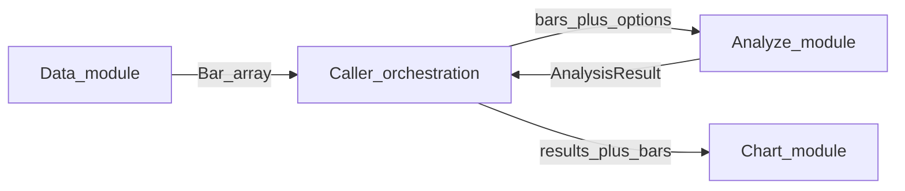
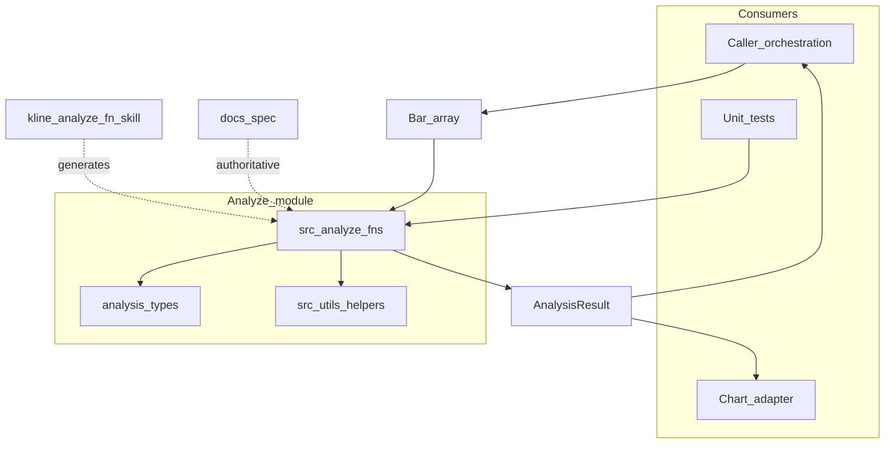
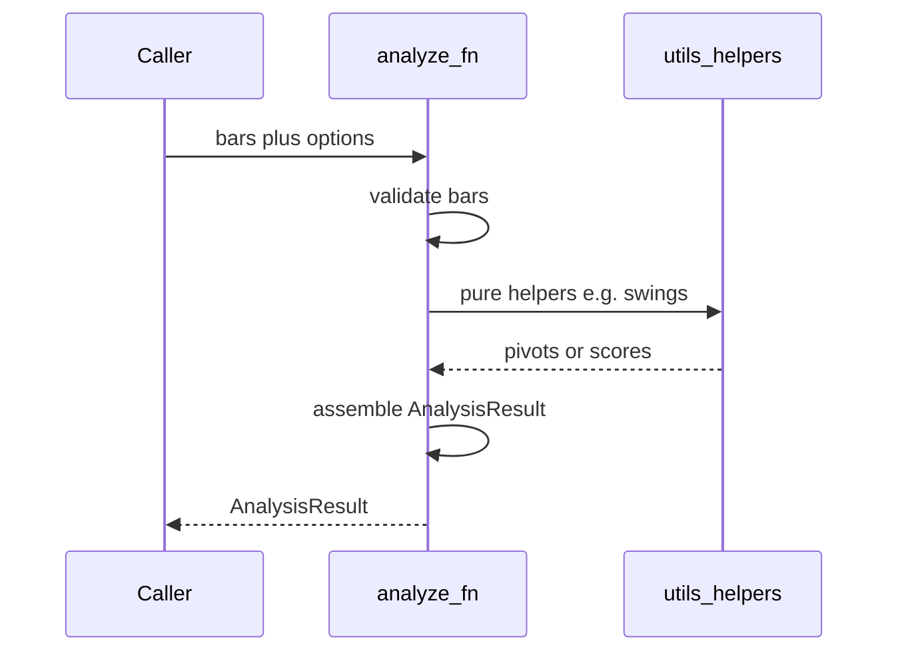
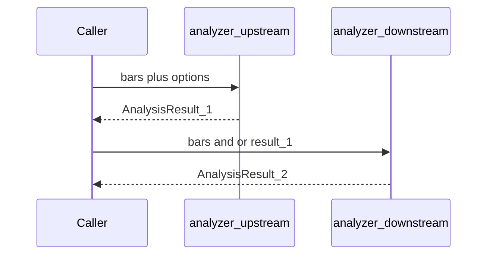

# Architecture: Analyze module

| Meta | Value |
|------|-------|
| Module | Analyze |
| Requirement | [FR-2](../requirements.md#fr-2-price-action-analysis-composable-functions) |
| Specification | [`../specification/analyze.md`](../specification/analyze.md) |
| Status | `classifyReversalSignal` and `classifySwingTrend` implemented; swing pivot helper still deferred |

---

## 1. Introduction and goals

Deliver composable price-action analysis functions that take MT5-aligned `Bar[]` (plus optional `options`) and return a unified `AnalysisResult` for chaining and for the Chart module (FR-3).

**Quality goals**

| Priority | Goal | Notes |
|----------|------|-------|
| 1 | Stable contract | Same I/O shape across all public analyzers |
| 2 | Purity | No HTTP / `fetchBars` / chart imports inside analyzers |
| 3 | Determinism | `confidence: 1`; “no pattern” → `results` item with a defined `name`, not throw |
| 4 | Reuse | Shared helpers under `src/utils/`; no copied algorithms |

Acceptance criteria: FR-2 **B1–B4** (see §10).

---

## 2. Constraints

| Constraint | Implication |
|------------|-------------|
| Node.js 18+ / TypeScript | Library-style modules; sync analyzers preferred |
| Bars from caller only | Input is `Bar[]`; Data module / orchestration owns loading |
| No chart dependencies | Analyzers stay importable without FR-3 libraries |
| No mandatory pipeline | Chaining is optional; no required orchestrator runtime |
| Per-function authority | Algorithms, labels, templates live in `docs/spec/`, not this arch doc |
| Extensible enums | New `AnalysisLabel` / `LevelName` update skill types-contract + `src/types` + function spec together |

---

## 3. Context and scope

### In scope

- Public analyzers: `(bars, options?) => AnalysisResult`
- Shared types (`AnalysisResult`, `AnalyzeResult`, `Level`, labels) and pure helpers (`time`, swings, `fillSummary`, …)
- Authoritative per-function specs under `docs/spec/` and generation via skill `kline-analyze-fn`

### Out of scope

- Fetching or inventing OHLC (Data module / caller)
- Chart / UI rendering (Chart module)
- Full catalog of every PA pattern in this document
- Mandatory multi-step pipeline framework

### System context

I/O and field semantics: [module specification](../specification/analyze.md). Shared types digest: [skill types-contract](../../.cursor/skills/kline-analyze-fn/references/types-contract.md).

---

## 4. Solution strategy

1. **Pure function surface** — Each capability is one export under `src/analyze/<functionId>.ts`; sync return; no I/O.
2. **Unified result** — Geometry in `results[].levels`, classification in `results[].name`, extras in `evidence`, prose only via summary templates.
3. **Shared helpers** — Extract swings, time conversion, `fillSummary`, etc. once under `src/utils/`.
4. **Spec-first extension** — New or changed behavior → `docs/spec/<kebab>.md`; prefer skill `kline-analyze-fn` for generation.
5. **Test with injected bars** — Unit tests pass synthetic `Bar[]`; never hit live MT5 inside analyzer tests.

Contract detail (fields, naming, errors): [specification § Shared contract](../specification/analyze.md#shared-contract-across-all-analysis-functions).

---

## 5. Building block view

| Building block | Path | Responsibility | Status |
|----------------|------|----------------|--------|
| Analysis types | [`src/types/analysis.ts`](../../src/types/analysis.ts) | `AnalysisResult`, `AnalyzeResult`, `Level`, `LevelName`, `AnalysisLabel` | done (`scaffold-types`; shape updated by `reshape-analysis-result`) |
| Bar types | [`src/types/bars.ts`](../../src/types/bars.ts) | MT5-aligned `Bar` (analyzer input) | done |
| Analyze module skeleton | [`src/analyze/index.ts`](../../src/analyze/index.ts) | `AnalyzerFn` + re-exports | done (`scaffold-analyze-module`) |
| Analyzers | `src/analyze/<functionId>.ts` | Pure PA functions | `classifyReversalSignal` and `classifySwingTrend` done |
| Time utils | [`src/utils/time.ts`](../../src/utils/time.ts) | Unix ↔ `TimeString` for `results[].levels` / `results[].range` | done |
| Summary helper | [`src/utils/summary.ts`](../../src/utils/summary.ts) | `fillSummary(template, vars)` | done (`util-fill-summary`) |
| Swing helper | `src/utils/swings.ts` *(planned)* | Shared pivot / swing detection | deferred (`util-swings`) |
| Function specs | [`docs/spec/`](../spec/) | Per-function algorithms and templates | seed exists |
| Generator skill | [`.cursor/skills/kline-analyze-fn/`](../../.cursor/skills/kline-analyze-fn/SKILL.md) | Scaffold new analyzers from intent | done |

Function index: [specification § Per-function specs](../specification/analyze.md#per-function-specs-index-only) (`classifyReversalSignal` and `classifySwingTrend` implemented).

---

## 6. Runtime view

### 6.1 Single analyzer (target)

Invalid args (e.g. non-array `bars`) throw. Empty / insufficient structure returns a `results` item whose `name` is a defined label such as `unclear` — does not throw.

### 6.2 Optional chaining (no pipeline runtime)

Caller composes calls; the module does not provide a required pipeline engine. Results remain JSON-serializable for FR-3.

---

## 7. Deployment and operations

| Topic | Detail |
|-------|--------|
| Runtime | In-process library; no separate Analyze service |
| Config | None specific to Analyze (instrument context stays with caller) |
| Unit tests | Inject `Bar[]`; assert `results[].name`, `levels`, `range`, `summary`, `confidence === 1` |
| Live MT5 | Forbidden in analyzer unit tests |
| Extension | Prefer skill + `docs/spec` before implementing |

---

## 8. Cross-cutting concepts

| Concern | Approach |
|---------|----------|
| Geometry | `results[].levels`: `{ name: LevelName, price, time: TimeString }` unless a function spec says otherwise |
| Classification | `results[].name` from the function’s allowed set; never overload meaning |
| Evidence | Always present; only facts not derivable from `results` / `summary` |
| Summary | Template + `fillSummary` only; no free-form prose; no required `symbol` / `timeframe` |
| Instrument context | Held by caller; not on analyzer input or `AnalysisResult` |
| Time | `Bar.time` = Unix seconds; `results[].range` / level times = `TimeString` |
| Serialization | `AnalysisResult` must stay JSON-serializable for Chart and external consumers |
| Reuse | Shared helpers in `src/utils/`; do not copy algorithms across analyzers |

---

## 9. Architecture decisions

| ID | Context | Decision | Consequences | Status |
|----|---------|----------|--------------|--------|
| D1 | Analyzers must not own market data | Input is `Bar[]` (+ optional `options`); no `fetchBars` inside | Pure, testable functions; caller/Data load bars | Accepted |
| D2 | Need chaining and Chart without a framework | Unified `AnalysisResult`; no mandatory pipeline runtime | Caller composes; stable JSON shape for FR-3 | Accepted |
| D3 | Geometry vs classification vs extras | `results[].levels` / `results[].name` / `evidence` / template `summary` | Clear ownership; adapters map each `Level` 1:1 | Accepted |
| D4 | Shared swing/time logic across functions | Extract once under `src/utils/` | Less duplication; B4 acceptance | Accepted |
| D5 | Extending PA catalog | Spec-first (`docs/spec`) + skill; enums synced in same change | Reviewable increments; contracts stay aligned | Accepted |

---

## 10. Quality requirements

Mapped from [specification Acceptance (B1–B4)](../specification/analyze.md#acceptance-from-requirements) / [requirements FR-2](../requirements.md#fr-2-price-action-analysis-composable-functions):

| ID | Scenario | Measure |
|----|----------|---------|
| B1 | Public analyzer shipped | `docs/spec` + matching export + tests |
| B2 | Result shape / enums | Conform to `AnalysisResult`; new labels/levels update types-contract + `src/types` |
| B3 | Unit tests / no pattern | Inject `Bar[]`; `results` item with defined `name` (e.g. `unclear`), not throw |
| B4 | Shared helpers | Swing/time (and summary) helpers reused, not duplicated |

---

## 11. Risks and technical debt

| Risk / debt | Impact | Mitigation |
|-------------|--------|------------|
| Swing pivot helper still deferred | No shared `src/utils/swings.ts` yet | Open `util-swings` only when a function needs pivots. `classifySwingTrend` uses reversal K2 nodes instead |
| Label/level sprawl without sync | Breaking or ambiguous consumers | Enforce same-change updates to skill + `src/types` + `docs/spec` |
| Caller forgets instrument context | Chart/UI must carry `symbol` / `timeframe` separately | Documented boundary in Data + Analyze + Chart specs |

---

## 12. Glossary and references

### Glossary

| Term | Meaning |
|------|---------|
| `Bar` | MT5-aligned OHLC candle; analyzer input element |
| `AnalysisResult` | Unified analyzer output (`functionId`, `results`, `summary`, `confidence`, `evidence`) |
| `AnalyzeResult` | One detected structure: `name` (`AnalysisLabel`), `range`, `levels` |
| `Level` / `LevelName` | Named geometric anchor → `{ name, price, time }` |
| `AnalysisLabel` | Machine-readable classification for a function |
| `functionId` | Export name / result id (camelCase) |
| Caller | Code that loads `Bar[]` and invokes analyzers (orchestration, tests, future CLI) |

### References

- Goal: [`../goal.md`](../goal.md)
- Requirements FR-2: [`../requirements.md#fr-2-price-action-analysis-composable-functions`](../requirements.md#fr-2-price-action-analysis-composable-functions)
- Module specification: [`../specification/analyze.md`](../specification/analyze.md)
- Data architecture (bar loading): [`data.md`](data.md)
- Seed function spec: [`../spec/classify-swing-trend.md`](../spec/classify-swing-trend.md)
- Reversal function spec: [`../spec/classify-reversal-signal.md`](../spec/classify-reversal-signal.md)
- Tasks: [`../project-tasks.md`](../project-tasks.md) (FR-2 this phase scaffolding: done)
- Skill: [`.cursor/skills/kline-analyze-fn/SKILL.md`](../../.cursor/skills/kline-analyze-fn/SKILL.md)
- Types contract: [`.cursor/skills/kline-analyze-fn/references/types-contract.md`](../../.cursor/skills/kline-analyze-fn/references/types-contract.md)
- Function contract: [`.cursor/skills/kline-analyze-fn/references/function-contract.md`](../../.cursor/skills/kline-analyze-fn/references/function-contract.md)
- Architecture index: [`README.md`](README.md)
