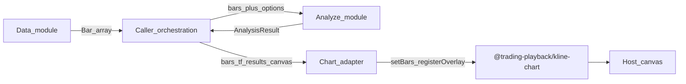
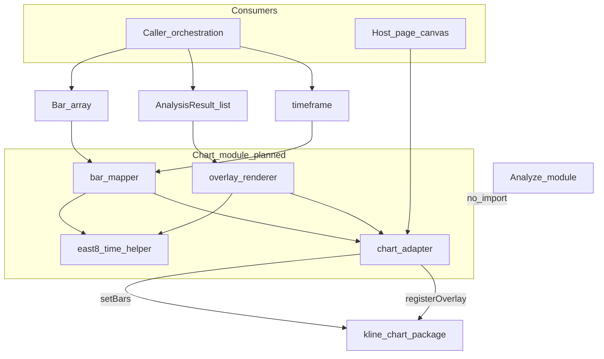
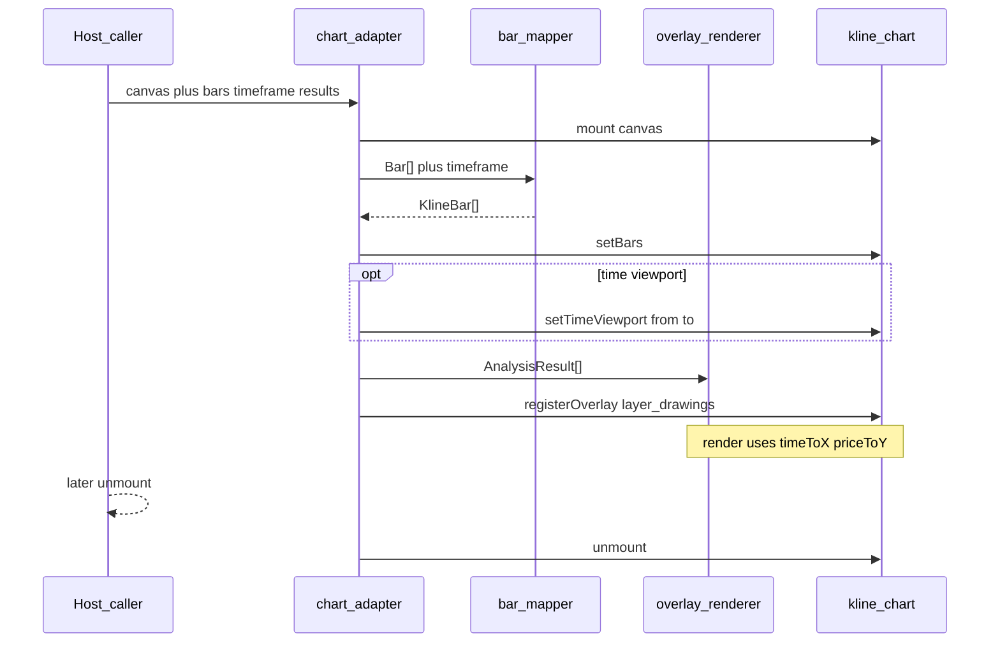
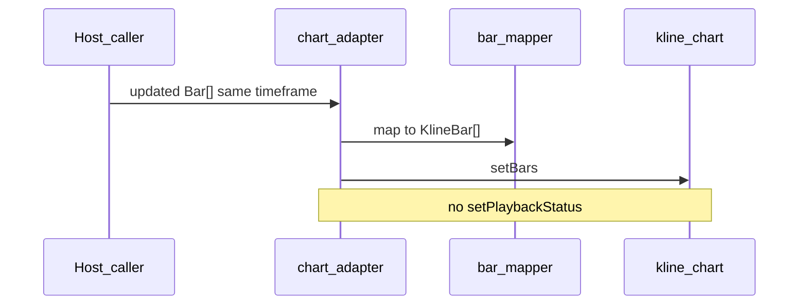
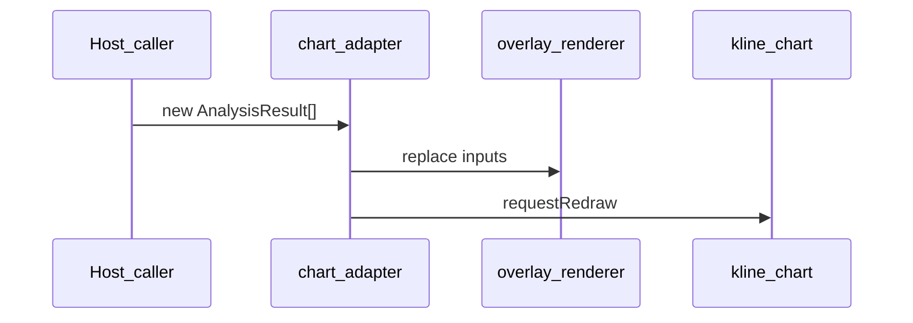

# Architecture: Chart module

| Meta | Value |
|------|-------|
| Module | Chart |
| Requirement | [FR-3](../requirements.md#fr-3-chart-render--annotation-third-party-library) |
| Specification | [`../specification/chart.md`](../specification/chart.md) |
| Status | Planned — library chosen (`@trading-playback/kline-chart`); adapter tasks: `chart-dep-kline-chart` … `chart-adapter-host` |

---

## 1. Introduction and goals

Render the query window’s candlesticks and overlay analysis geometry (`results[].levels`, optional `range`, `name` / `summary`) so callers can review price-action results on a chart. Candles are drawn by a third-party library; this module owns only a thin host adapter.

**Quality goals**

| Priority | Goal | Notes |
|----------|------|-------|
| 1 | Correct overlays | Each `results[].levels` entry maps 1:1 to a drawn mark; time = bar open |
| 2 | Window fidelity | Candles from `setBars` match the same bars / instrument context used for analysis |
| 3 | Dependency isolation | Chart package imported only inside the adapter; Analyze stays chart-free |
| 4 | Simple refresh | Static snapshot or replace bars via `setBars`; no playback state machine |

Acceptance criteria: FR-3 **C1–C4** (see §10).

---

## 2. Constraints

| Constraint | Implication |
|------------|-------------|
| Third-party render only | No custom candle engine; host supplies `HTMLCanvasElement` |
| Chosen library | `@trading-playback/kline-chart` (pure TS/JS, no React) |
| No native markers | Annotation via `registerOverlay` on `layer_drawings` |
| No playback | Do not call `setPlaybackStatus`; refresh = `setBars` again |
| Time formats differ | Repo bars / level times use UTC; library expects East-8 ISO-8601 (`+08:00`) |
| Analyze purity | `src/analyze` must not import the chart package |
| Install via `file:` | Outside `trading-playback` monorepo — not `workspace:*`; wire in `chart-dep-kline-chart` |
| Pointer / pan / zoom | Host responsibility; library exposes hit-test / coordinates only |

---

## 3. Context and scope

### In scope

- Thin adapter: mount / unmount, `Bar[]` → `KlineBar[]`, `setBars`, optional viewport / theme
- Overlay renderer: `AnalysisResult` → `layer_drawings` (`HostChildRenderer`)
- UTC → `+08:00` conversion at the chart boundary
- Static display and live candle refresh via repeated `setBars`

### Out of scope

- Fetching bars or running analyzers (Data / Analyze / caller)
- Custom canvas candle drawing
- Playback / scrubbing UI
- Full trading terminal, orders, or trade overlays (`layer_trades` unused)
- Indicator stack (`layer_indicators` unused)
- Published npm package as the only install path (use `file:` in `chart-dep-kline-chart` until then)

### System context

API, lifecycle, and field mapping: [module specification](../specification/chart.md). Upstream host guide: `D:\code\trading-playback\packages\kline-chart\docs\接入说明.md`.

---

## 4. Solution strategy

1. **Single import boundary** — Only code under `src/chart/` (planned) imports `@trading-playback/kline-chart`. Facades: `KlineChart` or `defaultKlineChart`.
2. **Map then paint** — Convert query-window `Bar[]` + caller `timeframe` to `KlineBar[]`, then `setBars`. Optionally `setTimeViewport` for the same window.
3. **Overlay, not markers** — Register one (or few) `HostChildRenderer`s on `layer_drawings`. Draw each `Level` in `results[].levels` with `timeToX` / `priceToY`; optional range band and name/summary text.
4. **Time at the edge** — Convert Unix seconds and UTC `TimeString` to `+08:00` before `setBars`, `setTimeViewport`, and `timeToX`. Do not pass raw Unix or `…Z` into the library.
5. **Refresh without playback** — New bars → `setBars` again. Overlay-only changes → update renderer inputs and `requestRedraw()`. Never drive `setPlaybackStatus`.
6. **Host owns interaction** — Pan, zoom, and pointer listeners stay outside the adapter unless a later host task needs `canvasPointFromClient` / `hitTest`.

Contract detail: [specification § Integration boundary](../specification/chart.md#integration-boundary), [§ Overlay mapping](../specification/chart.md#overlay-mapping).

---

## 5. Building block view

| Building block | Path | Responsibility | Status |
|----------------|------|----------------|--------|
| Chart adapter entry | `src/chart/` *(planned)* | `mount` / `unmount`, wire facade, expose a small host API | todo (`chart-adapter-host`) |
| Bar mapper | under `src/chart/` *(planned)* | `Bar[]` + `TimeFrame` → `KlineBar[]` (`+08:00`) | todo (`chart-map-bars-to-kline`) |
| Overlay renderer | under `src/chart/` *(planned)* | `AnalysisResult[]` → `layer_drawings` paint / optional hitTest | todo (`chart-overlay-analysis`) |
| Chart time helper | under `src/chart/` or extend `src/utils/time.ts` *(planned)* | UTC Unix / `TimeString` → East-8 ISO for the library | todo (`chart-util-east8-time`) |
| Package dependency | `package.json` *(planned)* | `file:` link to `@trading-playback/kline-chart` | todo (`chart-dep-kline-chart`) |
| Bar types | [`src/types/bars.ts`](../../src/types/bars.ts) | Input `Bar`, `TimeFrame` | done |
| Analysis types | [`src/types/analysis.ts`](../../src/types/analysis.ts) | `AnalysisResult`, `LevelName`, … | done (`scaffold-types`) |
| Third-party lib | `@trading-playback/kline-chart` | Candles, axes, crosshair, coordinates, overlay slots | external |

Analyze must remain importable with zero chart dependencies ([specification § Public surface](../specification/chart.md#public-surface-planned)).

---

## 6. Runtime view

### 6.1 Mount, paint candles, register overlay (target)

### 6.2 Live candle refresh (no playback)

### 6.3 Overlay-only update

Host lifecycle steps and optional appearance APIs: [specification § Host lifecycle](../specification/chart.md#host-lifecycle).

---

## 7. Deployment and operations

| Topic | Detail |
|-------|--------|
| Runtime | Browser (or any host with DOM canvas); library is not React-bound |
| Package install | `file:` to local `trading-playback/packages/kline-chart` (`chart-dep-kline-chart`) |
| Config | Optional `setConfig` / `setThemeColors` / `setPriceTickSize`; not required for C1–C4 |
| Env secrets | None specific to Chart; bars still come from Data / caller |
| Unit / adapter tests | Fixture `Bar[]` + fixed `AnalysisResult`; assert mapping and overlay inputs; no live MT5 |
| Teardown | Always `unmount()` when the host page tears down |

---

## 8. Cross-cutting concepts

| Concern | Approach |
|---------|----------|
| Geometry authority | `results[].levels` on each `AnalyzeResult`; adapter draws each `Level` |
| Instrument context | Caller-held `symbol` / `timeframe`; `timeframe` stamped on each `KlineBar` |
| Time (repo) | `Bar.time` = UTC Unix seconds; level / `results[].range` times = UTC `TimeString` |
| Time (library) | East-8 ISO-8601 with `+08:00` at the adapter edge |
| Overlay layer | `layer_drawings` only; indicators / trades unused |
| Refresh model | Replace candles with `setBars`; overlay-only → `requestRedraw` |
| Playback | Explicitly out of scope |
| Dependency direction | Caller → Chart → library; Analyze never depends on Chart |
| Interaction | Host listens for pointer / wheel; library provides coordinates / hitTest when needed |

---

## 9. Architecture decisions

| ID | Context | Decision | Consequences | Status |
|----|---------|----------|--------------|--------|
| D1 | Need candles without a custom engine | Use `@trading-playback/kline-chart` on a host canvas | Reuse existing paint/coords; adapter stays thin | Accepted |
| D2 | Library has no native marker API | Map `AnalysisResult` via `layer_drawings` `HostChildRenderer` | Adapter owns draw logic; 1:1 `results[].levels` still testable | Accepted |
| D3 | Review / annotate, not replay | Static or live `setBars` refresh; never `setPlaybackStatus` | Simpler host; C4 acceptance | Accepted |
| D4 | UTC in-repo vs East-8 in library | Convert only inside Chart adapter / chart time helper | Analyze and Data stay UTC; wrong format fails only at chart edge | Accepted |
| D5 | Package not in this monorepo | Install via `file:` in `chart-dep-kline-chart` | Adapter code can land after dep resolves; publish path later if needed | Accepted |
| D6 | Keep analyzers portable | Chart imports only under `src/chart/` | Satisfies C3; clear review boundary | Accepted |

---

## 10. Quality requirements

Mapped from [specification Acceptance (C1–C4)](../specification/chart.md#acceptance-after-library-integration) / [requirements FR-3](../requirements.md#fr-3-chart-render--annotation-third-party-library):

| ID | Scenario | Measure |
|----|----------|---------|
| C1 | Fixture bars + fixed `AnalysisResult` | `layer_drawings` marks match `results[].levels` entries 1:1 (bar-open time after `+08:00` conversion) |
| C2 | Query window shown | Candles from `setBars` match bars + caller `symbol` / `timeframe` / range |
| C3 | Analyze import graph | No chart package under `src/analyze` |
| C4 | Window refresh | Candles update via `setBars` only; playback status never set |

---

## 11. Risks and technical debt

| Risk / debt | Impact | Mitigation |
|-------------|--------|------------|
| Local `file:` dep may break on other machines | CI / clones need the sibling package path | Document path in `chart-dep-kline-chart`; switch to publish later if needed |
| East-8 conversion bugs | Misaligned markers vs candles | Shared chart time helper + tests against known bar opens |
| `toTimeString` is UTC-only today | Easy to pass `…Z` into the library by mistake | Do not reuse UTC helper as library input; document in adapter |
| Analysis types not in `src/types` yet | Overlay typing blocked / drift | `scaffold-types` before or with chart adapter |
| Host interaction deferred | Pan/zoom/hit-test may feel incomplete | Explicitly out of C1–C4; add host task later if needed |
| Upstream library API drift | Adapter breaks on package upgrades | Pin version; link 接入说明; retest mapping on bump |

---

## 12. Glossary and references

### Glossary

| Term | Meaning |
|------|---------|
| `KlineBar` | Library candle: `timeframe`, East-8 `time`, OHLC |
| Chart adapter | Thin module that mounts the library and maps repo types → library APIs |
| `layer_drawings` | Overlay slot used for analysis marks |
| `HostChildRenderer` | `{ id, render, hitTest? }` registered via `registerOverlay` |
| `CoordinateSystem` | Library helper: `timeToX` / `priceToY` / plot area |
| Static display | One `setBars` for the current window |
| Live update | Later `setBars` with a newer bar array; not playback |
| Caller | Orchestration / host page that holds canvas, bars, timeframe, and results |

### References

- Goal: [`../goal.md`](../goal.md)
- Requirements FR-3: [`../requirements.md#fr-3-chart-render--annotation-third-party-library`](../requirements.md#fr-3-chart-render--annotation-third-party-library)
- Module specification: [`../specification/chart.md`](../specification/chart.md)
- Analyze architecture: [`analyze.md`](analyze.md)
- Data architecture: [`data.md`](data.md)
- Tasks: [`../project-tasks.md`](../project-tasks.md) (`chart-dep-kline-chart`, `chart-util-east8-time`, `chart-map-bars-to-kline`, `chart-overlay-analysis`, `chart-adapter-host`)
- Upstream host guide: `D:\code\trading-playback\packages\kline-chart\docs\接入说明.md`
- Architecture index: [`README.md`](README.md)
