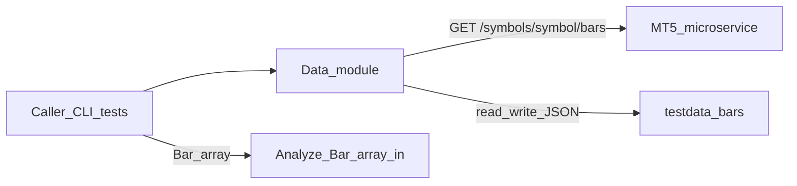
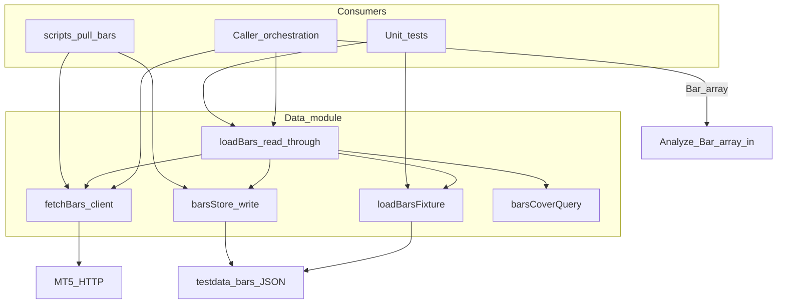
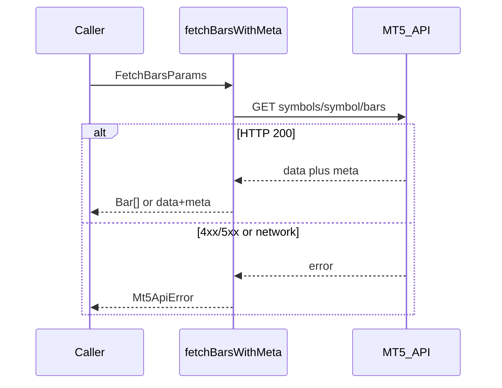
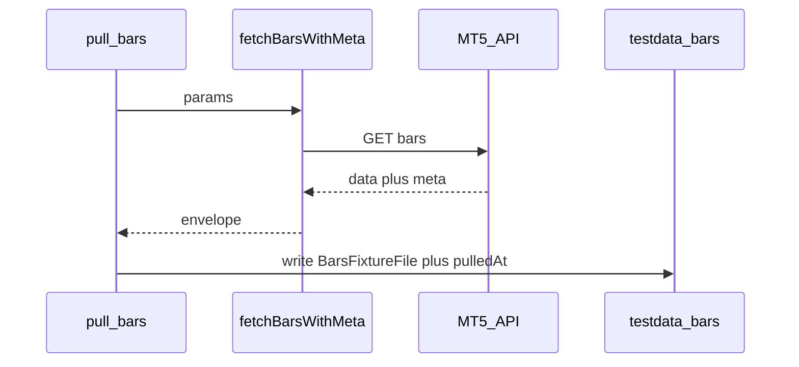
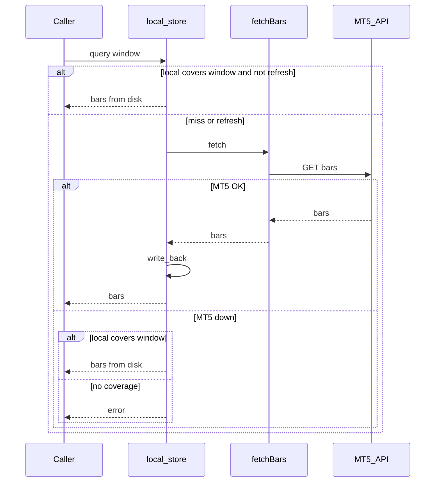

# Architecture: Data module

| Meta | Value |
|------|-------|
| Module | Data |
| Requirement | [FR-1](../requirements.md#fr-1-data-fetch--local-persistence) |
| Specification | [`../specification/data.md`](../specification/data.md) |
| Status | Done for FR-1 persist path — HTTP, JSON store, coverage, read-through / offline |

---

## 1. Introduction and goals

Provide OHLC `Bar[]` for a given `symbol + timeframe` window (range or last-N) so callers (CLI, orchestration, tests) can pull online, reuse locally, and inject bars into Analyze / Chart.

**Quality goals**

| Priority | Goal | Notes |
|----------|------|-------|
| 1 | Correctness | Never invent bars; propagate MT5 / HTTP failures |
| 2 | Offline reuse | After a successful pull, local data can satisfy covered queries without MT5 |
| 3 | Shared access | One HTTP client for CLI, orchestration, tests, and the future local store |
| 4 | Safe artifacts | Bulk dumps stay out of git |

Acceptance criteria: FR-1 **A1–A4** (see §10).

---

## 2. Constraints

| Constraint | Implication |
|------------|-------------|
| Node.js 18+ / TypeScript | Native `fetch`; ESM package layout |
| MT5 microservice only | Authoritative bars via configured `MT5_BASE_URL` |
| No WebSocket in MT5 bars API | “To now” = omit `to`; refresh is pull-based |
| Local store is not a second venue | Cache / offline replica of MT5 only |
| Bulk dumps gitignored | Default root `testdata/bars/**` not committed |
| Product store = JSON files | Root `testdata/bars/`; envelope `BarsFixtureFile`; tasks `persist-store-schema` / `persist-coverage` / `persist-read-through` |
| Analyze does not fetch | Analyzers take `Bar[]` only; Data / caller owns loading ([analyze specification](../specification/analyze.md)) |

---

## 3. Context and scope

### In scope

- Shared MT5 HTTP client for `/symbols/{symbol}/bars`
- Local write after successful pull; fixture load today; read-through / offline target
- CLI pull helper and gitignore policy for dumps

### Out of scope

- Becoming an independent market-data authority
- Tick streams, multi-broker merge, push subscriptions
- Non-JSON store engines (SQLite, etc.) in this phase
- Running PA algorithms or chart rendering (Analyze / Chart modules)

### System context

External authority: MT5 service (`D:\code\services\mt5`). Contract digest: [`.cursor/skills/kline-analyze-fn/references/mt5-bars-contract.md`](../../.cursor/skills/kline-analyze-fn/references/mt5-bars-contract.md). API and on-disk rules: [module specification](../specification/data.md).

---

## 4. Solution strategy

1. **Single HTTP client** — `fetchBars` / `fetchBarsWithMeta` encapsulate URL building, symbol encoding, env base URL, and `Mt5ApiError`. Analyzers do not call this client.
2. **Accept degraded service responses** — HTTP 200 with `meta.degraded` is valid data (service-side local fallback), not a client failure.
3. **Persist after pull** — Today: CLI writes `BarsFixtureFile` under `testdata/bars/`. Target: product store with read-through (local hit → miss/refresh → MT5 → write-back).
4. **Fail closed on transport/API errors** — Do not synthesize OHLC; let callers handle errors.
5. **Test without live MT5** — Data-client unit tests mock `fetch`; analyzer tests inject synthetic `Bar[]` or load fixtures via readers.

Endpoint and parameter detail: [specification § MT5 service calls](../specification/data.md#mt5-service-calls).

---

## 5. Building block view

| Building block | Path | Responsibility |
|----------------|------|----------------|
| Bar types | [`src/types/bars.ts`](../../src/types/bars.ts) | `Bar`, `TimeFrame`, `FetchBarsParams`, `BarsMeta`, `BarsFixtureFile` |
| MT5 client | [`src/data/fetchBars.ts`](../../src/data/fetchBars.ts) | HTTP GET, errors, `barsFixtureFileName` |
| Fixture readers | [`src/data/loadBarsFixture.ts`](../../src/data/loadBarsFixture.ts) | Load `Bar[]` or full fixture from disk |
| Bar guards | [`src/data/barGuards.ts`](../../src/data/barGuards.ts) | Shared `isBar` |
| Local store write | [`src/data/barsStore.ts`](../../src/data/barsStore.ts) | `barsStorePath`, `writeBarsFixture` |
| Pull CLI | [`scripts/pull-bars.ts`](../../scripts/pull-bars.ts) | Fetch + `writeBarsFixture` |
| Coverage | [`src/data/barsCoverage.ts`](../../src/data/barsCoverage.ts) | `barsCoverQuery` (endpoint rules) |
| Read-through | [`src/data/loadBars.ts`](../../src/data/loadBars.ts) | `loadBars` / `loadBarsWithMeta` |

---

## 6. Runtime view

Analyze is **not** a participant below; callers obtain `Bar[]` then pass them into analyzers.

### 6.1 Online fetch (current)

### 6.2 Pull and persist (current CLI)

Default path: `testdata/bars/<barsFixtureFileName>.json`. Filename and JSON shape: [specification § On-disk conventions](../specification/data.md#on-disk-conventions).

### 6.3 Read-through / offline (target)

---

## 7. Deployment and operations

| Topic | Detail |
|-------|--------|
| Config | `MT5_BASE_URL` (see [`.env.example`](../../.env.example)); override via client `baseUrl` |
| Default dump root | `testdata/bars/` |
| Git | Ignore `testdata/bars/**`; keep `.gitkeep` |
| CLI | `npm run pull-bars -- …` (`--out` overrides path) |
| Unit tests | Mock HTTP for the client / use fixtures; **no** live MT5 in CI unit tests |

---

## 8. Cross-cutting concepts

| Concern | Approach |
|---------|----------|
| Time on the wire | UTC Unix seconds (`Bar.time`, `from` / `to`) |
| Time in fixtures / LLM-facing fields | `TimeString` (ISO-8601 UTC), e.g. `pulledAt` |
| Symbol path | `encodeURIComponent`; server resolves aliases (`XAUUSD` → `XAUUSD+`) |
| Errors | `Mt5ApiError` with `code` / `status`; never fabricate OHLC |
| Security | Call only trusted/configured base URL; do not commit secrets or bulk dumps |
| Reuse | CLI, orchestration, tests, and the future store share `fetchBars*`; no parallel ad-hoc HTTP clients; analyzers receive `Bar[]` only |

---

## 9. Architecture decisions

| ID | Context | Decision | Consequences | Status |
|----|---------|----------|--------------|--------|
| D1 | Need a single authority for OHLC | MT5 microservice is the only authority; local files are cache/offline replicas | No dual pricing sources; offline limited by prior pulls | Accepted |
| D2 | Need fast/offline reuse without a heavy DB | Product local store = JSON under `testdata/bars/` (`BarsFixtureFile`); split into schema / coverage / read-through tasks | Fixture workflow works now; A2/A3 land with persist-* tasks | Accepted |
| D3 | CLI, orchestration, and tests need bars without duplicating HTTP | Shared `fetchBars` / `fetchBarsWithMeta`; Analyze stays fetch-free (`Bar[]` in) | One place for URL, errors, encoding; analyzers stay pure | Accepted |
| D4 | CI must be deterministic | Data-client tests mock HTTP or use fixtures; no live MT5 in unit CI | Live pulls remain manual / CLI | Accepted |

---

## 10. Quality requirements

Mapped from [specification Acceptance (A1–A4)](../specification/data.md#acceptance-from-requirements) / [requirements FR-1](../requirements.md#fr-1-data-fetch--local-persistence):

| ID | Scenario | Measure |
|----|----------|---------|
| A1 | Range and “to now” (omit end) when MT5 is up | Successful `fetchBars*` against live or mocked contract |
| A2 | After successful pull | Same window readable from local store without a second MT5 call |
| A3 | MT5 down, local covers window | Load succeeds from local |
| A4 | Unit test suite | Mock/fixture only; no live MT5 |

---

## 11. Risks and technical debt

| Risk / debt | Impact | Mitigation |
|-------------|--------|------------|
| Callers may still use CLI / `fetchBars` directly | Bypass of read-through cache | Prefer `loadBars` for product reads |
| Session gaps not scanned | FX weekend holes can still “cover” by endpoints | Documented v1 limit; revisit if needed |
| Layout locked to JSON for now | Later engine change needs migration | Keep `testdata/bars/` root; update arch + specification if engine changes |
| Relying on service `degraded` semantics | Client may serve stale/partial service-local data | Document acceptance of `meta.degraded`; callers may inspect `meta` via `fetchBarsWithMeta` |

---

## 12. Glossary and references

### Glossary

| Term | Meaning |
|------|---------|
| `Bar` | Single OHLC candle; `time` is Unix seconds (MT5 wire shape) |
| `BarsFixtureFile` | On-disk `{ data, meta, pulledAt? }` aligned with MT5 envelope |
| `degraded` | MT5 `meta` flag: service used local fallback; still valid bars for this client |
| Read-through | Prefer local; on miss/refresh call MT5 and write back |
| Coverage | Local data fully spans the requested window |
| Caller | CLI, orchestration, or test code that loads `Bar[]` and may pass them to Analyze |

### References

- Goal: [`../goal.md`](../goal.md)
- Requirements FR-1: [`../requirements.md#fr-1-data-fetch--local-persistence`](../requirements.md#fr-1-data-fetch--local-persistence)
- Module specification: [`../specification/data.md`](../specification/data.md)
- Analyze boundary: [`../specification/analyze.md`](../specification/analyze.md)
- Tasks: [`../project-tasks.md`](../project-tasks.md) (FR-1 persist tasks done)
- MT5 bars contract digest: [`.cursor/skills/kline-analyze-fn/references/mt5-bars-contract.md`](../../.cursor/skills/kline-analyze-fn/references/mt5-bars-contract.md)
- MT5 API (authoritative): `D:\code\services\mt5\docs\API.md`
- Architecture index: [`README.md`](README.md)
