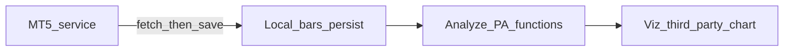

# Project goal

## One-liner

On K-line data for a given `symbol + timeframe + [start, end|now]`, locate candles and price points that match price-action rules, and mark those results on the corresponding chart.

## Success criteria

1. **Data** — Fetch historical and “to now” bars from the MT5 microservice, **persist them locally**, and support fast reuse plus offline reads when the local copy covers the query window.
2. **Analyze** — Deliver price-action capabilities as composable analysis functions with a unified `AnalysisResult`, suitable for chaining and downstream consumers.
3. **Visualize** — Chart layer consumes analysis output and marks levels / structure on the same query window via `@trading-playback/kline-chart` (static candles, or live refresh through `setBars`; no playback).

## Capability layers

| Layer | Role |
|-------|------|
| MT5 + local persist | Authoritative pull from MT5; local cache/offline copy in this repo |
| Analyze | Price-action detectors as functions; shared helpers; unified return shape |
| Viz | Third-party K-line render + markers mapped from `AnalysisResult` |

Detailed requirements: [`requirements.md`](requirements.md).

## Boundaries

- **Authoritative source** for bars is the MT5 microservice (`D:\code\services\mt5`). Local storage is a cache / offline replica, not a second market-data source.
- **“Realtime”** means omit `end`/`to` (server = now), optionally refresh-pull and write back locally. No WebSocket / push stream in v1 (MT5 API has none).
- Price-action rules are split into functions; each has [`docs/spec/<functionId-kebab>.md`](spec/). Seed: [`classify-swing-trend.md`](spec/classify-swing-trend.md).
- Chart rendering uses `@trading-playback/kline-chart` (host canvas + overlay on `layer_drawings`). Analyzers stay chart-library-agnostic and expose stable `AnalysisResult`. No playback UI.
- Not a full trading terminal; chart scope is review / annotate from analysis results.

## Related docs

| Doc | Purpose |
|-----|---------|
| [`requirements.md`](requirements.md) | FR / NFR / acceptance |
| [`specification/`](specification/) | Module specs (data / analyze / chart) |
| [`architecture/`](architecture/) | Module architecture (structure, runtime, decisions) |
| [`project-tasks.md`](project-tasks.md) | Local task tracker |
| [`spec/`](spec/) | Per-function authoritative specs |
| Skill `kline-analyze-fn` | Generator + contracts for new analyzers |
