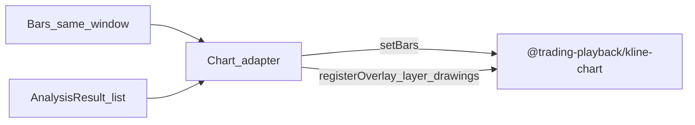

# Module: Chart (FR-3)

Maps to: [`../requirements.md`](../requirements.md) § FR-3.  
Parent goal: [`../goal.md`](../goal.md).

Library integration source: `D:\code\trading-playback\packages\kline-chart\docs\接入说明.md`.

## Purpose

Render the same query window’s candlesticks and overlay analysis markers (`results[].levels`, optional range highlight, name/summary) so users can see price-action results on a chart.

Display is **static** (one `setBars`) or **live-updated** (call `setBars` again when the window’s bars change). Playback is not part of this module.

## Library

| Item | Decision |
|------|----------|
| Package | `@trading-playback/kline-chart` |
| Runtime | Pure TypeScript / JavaScript. No React. Host supplies the page and an `HTMLCanvasElement` |
| Entry | Facade `KlineChart`, or the exported singleton `defaultKlineChart` |
| Install | `file:` to local `trading-playback/packages/kline-chart` (`chart-dep-kline-chart`). Do not use `workspace:*` |
| Import site | Only the chart adapter (path TBD, e.g. `src/chart/`) |

## Responsibilities & non-goals

| In scope | Out of scope |
|----------|--------------|
| Mount the library on a host canvas and draw the query window | Custom canvas / self-drawn candle engine |
| Map `Bar[]` + caller `timeframe` → `KlineBar[]` and call `setBars` | Fetching bars inside the chart module |
| Map `AnalysisResult` → a `layer_drawings` overlay renderer | Native “marker” widgets (this library has none) |
| Static snapshot, or replace bars on refresh (`setBars`) | Playback (`setPlaybackStatus` and `'not_started' \| 'playing' \| 'paused' \| 'ended'`) |
| Convert UTC times to East-8 ISO-8601 before chart calls | Full trading terminal / order UI |
| Keep analyzers free of chart imports | Embedding chart deps inside `src/analyze` |

Pointer, wheel, pan, and zoom stay with the **host**. The library does not bind those listeners. Hit-testing is available (`canvasPointFromClient` + `hitTest`) but is not required for the static / live-update acceptance below.

## Integration boundary



| Side | Responsibility |
|------|----------------|
| Caller | Query-window `Bar[]`, caller-held `symbol` / `timeframe`, one or more `AnalysisResult` |
| Chart adapter | `mount` / `unmount`, `Bar[]` → `KlineBar[]`, time conversion, `setBars`, `setTimeViewport`, `layer_drawings` overlay, `requestRedraw` after overlay data changes |
| Library | Candles, axes, crosshair, empty state, coordinate conversion, overlay paint slots |
| Analyze | No import of this package |

### Host lifecycle

1. Provide a `<canvas>` and a parent used for size.
2. `mount(canvas, { container, onReady? })`. `mount` syncs canvas size to the container; call `resize(width, height)` only when the host owns sizing.
3. `setBars(bars)` for the window. Optionally `setTimeViewport`, `setConfig`, `setThemeColors`, `setPriceTickSize`.
4. `registerOverlay({ layerId: 'layer_drawings', renderer })` for analysis marks. The returned function unregisters (equivalent to `unregisterOverlay`).
5. On later bar refresh, call `setBars` again. If only overlay inputs changed, call `requestRedraw()`.
6. On teardown, `unmount()`.

Do not call `setPlaybackStatus`.

## Inputs

| Input | Notes |
|-------|-------|
| Bars | Same window shown on the chart; also the `Bar[]` passed into analyzers. `time` is UTC Unix seconds |
| Instrument context | Caller-held `symbol` / `timeframe` (not on `AnalysisResult`). `timeframe` is copied onto each `KlineBar` |
| `AnalysisResult[]` | One or more function outputs. Geometry from `results[].levels` (`time` is UTC `TimeString`) |
| Canvas | Host `HTMLCanvasElement` plus layout container |

The library does not load market data. The adapter guarantees time order and field validity.

### `Bar` → `KlineBar`

| `KlineBar` | Source |
|------------|--------|
| `timeframe` | Caller `TimeFrame` (`H1`, `M15`, …) |
| `time` | `Bar.time` converted to East-8 ISO-8601, including `+08:00` |
| `open` / `high` / `low` / `close` | Same fields on `Bar` |

`toTimeString` in `src/utils/time.ts` emits UTC (`…Z`) only. The `+08:00` string is an adapter concern; do not pass UTC `Z` or raw Unix seconds into `setBars` or `timeToX`.

Volume fields on `Bar` are not part of `KlineBar`.

### Viewports

| Viewport | Shape | Use |
|----------|-------|-----|
| Time | `{ from: string; to: string }` | Query window, same `+08:00` format as `KlineBar.time`. Set with `setTimeViewport` |
| Price | `{ min: number; max: number }` | Optional. Read back via `getViewport()` with the time viewport |

### Appearance (optional)

Not required for FR-3 acceptance. Partial updates are supported.

| API | Fields |
|-----|--------|
| `setConfig` / `getConfig` | `scaleMode` (`'linear' \| 'log' \| 'auto'`), `rightMarginRatio`, `bullColor` / `bearColor`, `gridColor` / `plotBorderColor`, `gridDashLength` / `gridDashGap`, `fontSize`. Defaults: `DEFAULT_KLINE_CHART_CONFIG` |
| `setThemeColors` / `getThemeColors` | `bg`, `fg`, `border`, `muted`, `grid`, `crosshairStroke`, `crosshairLabelBg`, `crosshairLabelFg` |
| `setPriceTickSize` | Minimum price increment for axis labels |

`reset()` clears data and config-related state and restores the default theme and tick size. The adapter should not call it as part of a normal refresh (`setBars` is enough).

## Overlay mapping

Analysis marks go through `registerOverlay` on **`layer_drawings`** only.

| `layerId` | This module |
|-----------|-------------|
| `layer_drawings` | Levels, range highlight, name / summary text |
| `layer_indicators` | Unused |
| `layer_trades` | Unused |

`HostChildRenderer`:

```ts
{
  id: string; // unique within the layer
  render(ctx, coordinateSystem, context): void;
  hitTest?(point): { layerId: string; target: unknown } | null;
}
```

Draw with the coordinate system from `withCoordinateSystem` or `getCoordinateSystem()` (`CoordinateSystem`):

| Method | Use |
|--------|-----|
| `timeToX(time)` / `xToTime(x)` | East-8 time string ↔ screen X. Convert level / range times before `timeToX` |
| `priceToY(price)` / `yToPrice(y)` | Price ↔ screen Y |
| `getPlotArea()` | Main plot rectangle |
| `barCenterX(barIndex)` | Candle center X when the index is known |

Minimum mapping:

- Each `Level` in `results[].levels` → one point at `(timeToX(time+08), priceToY(price))` labeled with `Level.name` (`H1`, `L2`, …). Count matches level entries across the supplied results.
- Optional: highlight each item’s `range.start`–`range.end` (convert both; `end` may be absent).
- Optional: draw `results[].name` / outer `summary` as text inside the plot. The library has no legend API.

Anchor remains the bar open time. After overlay inputs change, `requestRedraw()`.

Pointer hits, when the host implements them: `canvasPointFromClient(canvas, clientX, clientY)` then `hitTest({ x, y })`. Overlay `hitTest` may return `{ layerId, target }`.

## Public surface (planned)

| Piece | Notes |
|-------|-------|
| Adapter module | e.g. `src/chart/` — only place that imports `@trading-playback/kline-chart` |
| Analyze package | Importable with **zero** chart dependencies |

## Behaviors

1. The candles on screen are the mapped query-window bars (same OHLC; times shown as `+08:00`).
2. A later refresh replaces those candles by calling `setBars` again. No playback state machine.
3. Drawn level marks correspond 1:1 with `results[].levels` entries on the result(s).
4. Analyzers never import the chart package.

## Current vs target

| Piece | 现状 | Notes |
|-------|------|-------|
| Library choice | decided | `@trading-playback/kline-chart`; install via `file:` (`chart-dep-kline-chart`) |
| Adapter (`setBars` + `layer_drawings`) | todo | `chart-dep-kline-chart` → … → `chart-adapter-host` |
| Playback | out of scope | Do not call `setPlaybackStatus` |

## Acceptance (after library integration)

| # | Criterion |
|---|-----------|
| C1 | Given fixture bars + fixed `AnalysisResult`, `layer_drawings` marks match `results[].levels` entries 1:1 (time = bar open, after `+08:00` conversion) |
| C2 | Query window (symbol / timeframe / range) matches the candles from `setBars` |
| C3 | Analysis packages remain importable without chart dependencies |
| C4 | Refreshing the window updates candles via `setBars` only; playback status is never set |

## Related

- Architecture: [`../architecture/chart.md`](../architecture/chart.md)
- Requirements: [`../requirements.md`](../requirements.md) FR-3
- Analyze shared contract: [`analyze.md`](analyze.md)
- Tasks: [`../project-tasks.md`](../project-tasks.md) (`chart-dep-kline-chart`, `chart-util-east8-time`, `chart-map-bars-to-kline`, `chart-overlay-analysis`, `chart-adapter-host`)
- Module index: [`README.md`](README.md)
- Upstream host guide: `D:\code\trading-playback\packages\kline-chart\docs\接入说明.md`
